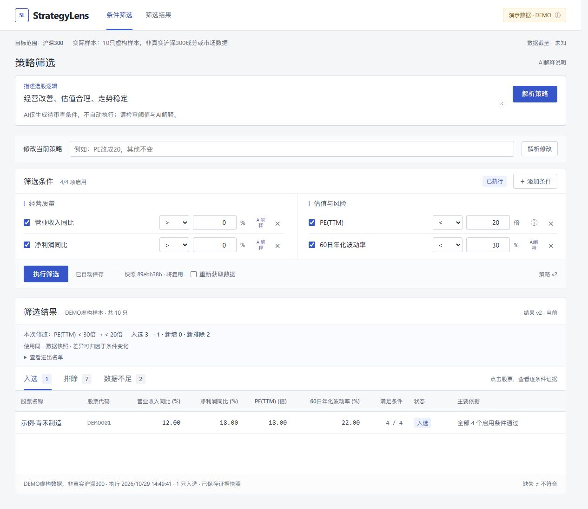
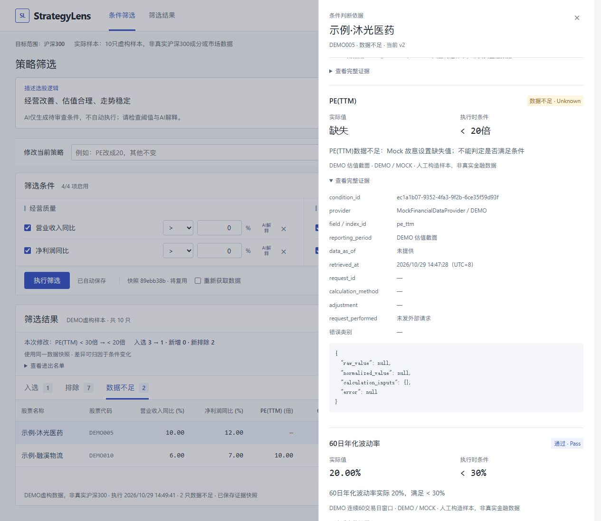

# StrategyLens｜自然语言智能选股与策略解释器

面向模糊投资判断落地的可审计策略工作台。运行时模型为 **SiliconFlow `Qwen/Qwen3-8B`**，金融数据来自**同花顺扶摇**。功能冻结于2026-10-29；本项目是研究与产品验证工具。

## 界面预览

以下为真实运行时模型接入后的最终界面截图，**股票数据为虚构DEMO**，不是真实市场结果。REAL十只验证样本及审查修正说明见[最终验证记录](docs/FINAL_VALIDATION.md)。仓库只保留这两张展示图，中期截图与测试输出不上传。





## 1. 用户问题

“经营改善、估值合理、走势稳定”不是可以直接执行的数据规则。用户需要检查这些话被转成了什么条件、哪些是AI的临时解释、每只股票为何进入或退出，以及结果变化是否仅来自条件调整。

## 2. 为什么不是普通AI荐股

产品输出先是可编辑的Strategy Draft，再由确定性程序筛选。用户审查条件后才能执行；局部修改先预览再确认。LLM不查询金融事实、不计算波动率、不裁决股票、不作收益承诺或直接买卖建议。

## 3. 竞品与机会

自然语言选股本身不是创新。问财、TradingView等已有成熟筛选能力；StrategyLens聚焦于把条件审查、来源、逐条件Evidence、Missing≠Fail和固定快照What-if连成可回看的流程，不声称独家或首创。公开资料不能确认的竞品能力不等同于“不支持”。见[竞品研究](docs/COMPETITOR_RESEARCH.md)与[产品规格](docs/PRODUCT_SPEC.md)。

## 4. 核心工作流

自然语言 → 待审查条件 → 确认/修改 → 执行 → Selected/Excluded/Unknown → Evidence → 自然语言局部Patch → 预览确认 → stale → 同Snapshot重新执行。

**最终验证有明确限制：**新句式“帮我找估值不要太高、最近走势比较稳定的股票。”被模型错误解释为两个`>=30`。保留原始输出；未改Prompt、型号、参数。随后由用户授权的审查脚本将方向修正为`<30`，再复用真实快照验证。不能宣称原始LLM编译全自动正确，也没有虚构人工点击。详情见[最终验证](docs/FINAL_VALIDATION.md)。

## 5. 职责边界

| 层 | 职责 |
| --- | --- |
| LLM Compiler | 语义草稿、来源/解释、局部Patch；输出经严格Schema、allowlist与程序规则校验 |
| Domain Engine | 金融条件比较、三态判断、冲突与结果 |
| Financial Adapter | 官方鉴权与取数、单位/缺失转换、请求追溯；不决定入选 |
| SQLite / Session | revision、stale、不可变Snapshot、Evidence与执行记录；默认重用快照 |
| 原生前端 | 审查编辑、表格比较、证据抽屉、修改预览与Diff |

## 6. DEMO与REAL模式

- `mock`：10只虚构样本，非真实沪深300成分或市场数据；用于稳定展示四条件、三态和缺失Evidence。
- `fuyao_validation`：**真实验证样本：10只沪深300当前成分股**。执行时向官方查询`000300.SH`全部当前成分，按代码升序取前10只；不手工维护名单，不是完整沪深300筛选。范围与样本代码随Snapshot保存。
- 真实模式失败不自动换Mock。Compiler的demo/llm模式与金融模式独立，固定模板不是运行时理解。
- 旧`fuyao`完整范围入口保留兼容，未在最终验证运行，不建议用于截止前演示。

## 7. 当前指标

| 指标 | 单位 | REAL验证状态 |
| --- | --- | --- |
| PE(TTM) | 倍 | 10/10实际取到；保留原始值与官方时点 |
| 60日年化波动率 | % | 10/10由真实前复权日K程序计算 |
| 营收同比 | % | 财务index_id契约不一致，未映射；真实样本模式不请求，Unknown |
| 净利润同比 | % | 同上，不把归母净利润擅自替代净利润 |

波动率使用截至上海当前日之前的最后61个完整交易日收盘价，形成60个simple returns：`close[t]/close[t-1]-1`，取sample standard deviation（ddof=1），乘`sqrt(252)*100`。本次实际区间2026-07-28至2026-10-28。数据不足不缩短窗口、不补0。

## 8. Evidence与Unknown

每条件保留实际值、执行阈值、Pass/Fail/Unknown及来源。金融Evidence记录provider、field、raw/normalized、单位、retrieved_at、data_as_of、报告期、request_id；派生指标另有adjustment、公式和实际交易日范围。缺失不等于0或Fail。有Fail则Excluded；无Fail但有Unknown则Unknown；全部Pass才Selected。财务未请求的Evidence明确request_performed=false，不能冒充线上取数。

## 9. Snapshot-controlled What-if

结果绑定strategy revision与snapshot_id。修改条件后旧结果stale；只有相同snapshot_id才能归因于条件变化。显式刷新会取新快照并警告数据也变了。刷新页面只读取SQLite，不重新取数。汇总data_as_of仅表示最晚已知上游时点，各证据并非同步。

## 10. 系统架构

`app/api/` API；`app/services/` Compiler与Session；`app/domain/` 模型、引擎、冲突、波动率；`app/adapters/` Mock与扶摇（含有界真实验证样本）；`app/store/` SQLite；`static/` HTML/CSS/JS；`tests/` 自动化与固定评测集；`scripts/` 启动、验证与打包；`docs/` 产品、竞品、设计及验证。

## 11. 本地启动

在README所在目录使用现有Python虚拟环境，不需要删除/重建。全新环境可创建Python3.11+虚拟环境并安装requirements.txt。

```powershell
# 已在Windows用户环境变量保存两个Key时；脚本安全重新读取，不回显凭证。
.\scripts\start_llm.ps1 -FinancialProvider fuyao_validation -Database data/final-real.sqlite3
# 独立DEMO工作台：
# .\scripts\start_llm.ps1 -FinancialProvider mock -Database data/demo.sqlite3
```

访问 http://127.0.0.1:8767/ 。旧服务先在其终端按Ctrl+C停止。保存的策略可用`?strategy_id=策略ID`打开。最终源码ZIP不包含运行库或凭证，解压后需自行配置环境和Key；旧电脑上的缓存结果不随源码迁移。

无模型额度时可保留已保存结果、手动编辑和筛选，或将STRATEGYLENS_COMPILER设为demo后用标准uvicorn启动。DEMO Compiler也可以搭配真实金融模式，但必须手工审查并禁用未验证的财务条件。

## 12. 环境变量

| 变量 | 作用 |
| --- | --- |
| SILICONFLOW_API_KEY | 硅基流动凭证，仅环境变量 |
| HITHINK_FINANCE_API_KEY | 扶摇凭证，仅环境变量 |
| STRATEGYLENS_COMPILER | demo（默认固定模板）或llm |
| STRATEGYLENS_LLM_PROVIDER | siliconflow；保留显式zhipu兼容，禁止自动切换 |
| STRATEGYLENS_LLM_MODEL | Qwen/Qwen3-8B（冻结） |
| STRATEGYLENS_PROVIDER | fuyao_validation（默认）、mock；fuyao为旧完整范围入口 |
| STRATEGYLENS_DB | SQLite路径，默认data/strategylens.sqlite3 |
| FUYAO_MIN_INTERVAL / FUYAO_TIMEOUT | 默认串行间隔1秒/超时20秒 |
| FUYAO_REPORT | 仅旧完整财务路径使用；最终双指标样本不需要报告期 |

.env.example只列配置变量，不含Key；应用不自动读取.env。不要把凭证发到聊天、写源码或提交。保留本地.venv、缓存和SQLite，通过.gitignore与源码包排除，不删除开发环境。

## 13. 测试与真实验证

```powershell
.\.venv\Scripts\python.exe -m pytest -q
node --test tests/workspace_core.test.mjs
node --check static/app.js
node --check static/workspace-core.mjs
# 有模型额度时才运行；本轮因用户额度用尽不再调用：
# .\.venv\Scripts\python.exe -m scripts.eval_llm
```

26条固定集明确称为 **Development Evaluation**，不是独立Blind Test或泛化证明。上轮最终19个模型样本、7个程序预检样本全部断言通过；本轮新句式仍出现方向错误，说明Schema合法不保证语义正确。本轮不再为分数调整Prompt或建设大规模盲测。

最终真实数据：成分300只返回成功；仅扫描确定性10只；PE10/10、61根前复权日K与波动率10/10，共13次金融请求。审查修正后PE<30、波动率<30得到5入选/5排除/0数据不足；PE改20后仍5/5/0，同一真实Snapshot、无新增金融请求。这次样本没有真实缺失，不能伪造Unknown；Unknown能力由DEMO及离线测试覆盖。测试最终数字见[TEST_PLAN](docs/TEST_PLAN.md)。

## 14. AI Coding使用与验证

AI参与模型契约、Adapter、界面、测试与文档；AI产物以Schema、确定性程序、真实请求和测试验证。原始证据按真实时间保存在[AI_DEV_LOG](AI_DEV_LOG.md)，不把晚做研究伪装成前期成果。

关键Bad Cases：A. HTTP200/code0仍可能缺少约定财务字段，需核验字段/语义/单位/Evidence；B. “其他不变”必须保留非目标Condition；C. “严格一点”要求澄清，不猜阈值；D. 本轮新句式方向反转，必须审查，开发集100%不能代替泛化验证。未虚构用户人工修改Prompt或点击确认。

## 15. 正式交付包

```powershell
.\.venv\Scripts\python.exe -m scripts.package_release
```

输出artifacts/StrategyLens-workspace-source.zip及外部SHA256 manifest。脚本检查运行时Compiler、真实Adapter、Snapshot/Evidence实现、必要文档/测试/静态文件，逐文件比对源码与ZIP，扫描已配置凭证与token格式。排除环境、缓存、.env、SQLite、临时截图、日志及旧归档；Authorization/Bearer/X-api-key作为必要源码字段名可出现，真实值与含凭证的请求日志不得出现。

## 16. Known Limitations与Non-goals

原始LLM方向错误尚未通过Prompt调优解决，现有校验未能完全拦截语义误读；最终验证脚本已增加方向检查，出错立即停止。演示前必须审查条件。财务契约仍未确认；负PE的产品语义未扩展；仅10只验证、未测完整300只性能；没有独立盲测、长期稳定性或多用户并发验收。资金决策由用户负责。

不包含新闻/RAG、LangGraph、多Agent、回测、自动交易、监控、收益预测、行业相对估值或更多指标。本轮交付后冻结功能，不继续扩展。
